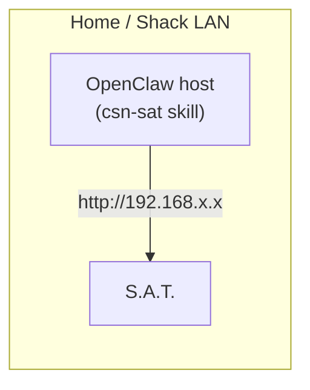
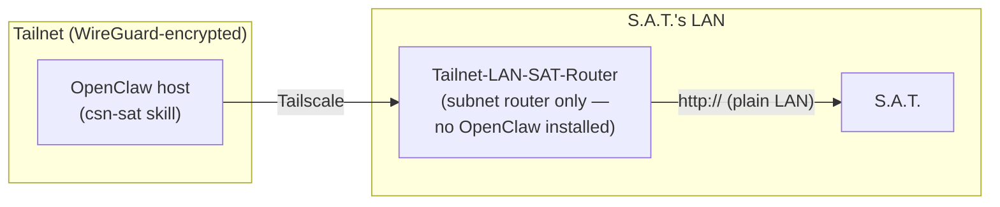
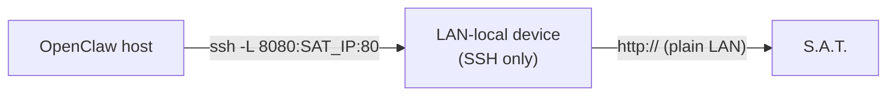

# Deployment

The S.A.T. only speaks plain HTTP on its local network, and has **no authentication** —
anything that can reach its IP on port 80 can move the antenna. This skill (and the
`satctl.py` CLI it wraps) just needs a plain TCP/IP path from wherever OpenClaw runs to
that IP. How you build that path depends on where OpenClaw runs relative to the S.A.T.'s
LAN. This doc lays out the common topologies.

## Quick setup

The skill ships a wizard that walks through the setups below:

```bash
python3 ~/.openclaw/workspace/skills/csn-sat/scripts/setup.py
```

```text
How does this OpenClaw host reach the S.A.T.?
  0) Automatically detect (recommended)
  1) Same LAN: OpenClaw runs on the S.A.T.'s network (Deployment.md §1)
  2) Tailscale subnet router: another device on the S.A.T.'s LAN advertises a route (§2)
  3) SSH tunnel through a device on the S.A.T.'s LAN (§3)
  4) OpenClaw installed on the LAN-local device itself (§4)
  q) Quit
```

**Automatically detect** tries the current `CSN_SAT_HOST`, every single-host (`/32`) route
advertised on your tailnet, and an SSH tunnel on `localhost:8080`. It keeps only addresses
that answer like an S.A.T. and tells you which setup it found. If a tailnet route exists but
this host ignores subnet routes, it offers to run `sudo tailscale set --accept-routes`. The
specific options ask for what each setup needs (IP, route, SSH login), and option 3 can start
the tunnel for you. The wizard asks before every change and finally saves `CSN_SAT_HOST`.

- `--check`: detect and report only, change nothing (the agent uses this when the S.A.T.
  is unreachable).
- `--auto`: skip the menu. `--topology lan|tailscale|ssh|local`: go straight to one setup.
- `--yes`: save the detected address without asking (never implies `sudo` or `ssh`).

The wizard can't approve a subnet route in the Tailscale admin console or make an SSH tunnel
survive reboots; those steps are described below.

## 1. OpenClaw on the same LAN as the S.A.T.

The simplest case: the machine running OpenClaw is already on the same local network as
the S.A.T. (e.g. a shack computer on the home WiFi).



Set `CSN_SAT_HOST` to the S.A.T.'s LAN IP (or mDNS hostname, if your resolver supports
it). Nothing else is required.

## 2. OpenClaw on a different network, reached via a Tailscale subnet router

If OpenClaw runs somewhere that is **not** on the S.A.T.'s LAN — a cloud box, your main
desktop on a different network, etc. — but you have a small always-on device (a
Raspberry Pi, for example) that *is* on the S.A.T.'s LAN and already joined to your
tailnet, that device can act as a **subnet router**: it advertises a route into its LAN
over Tailscale and then does nothing but forward packets. It does not need to run
OpenClaw, Node, or anything else — this keeps the CPU/RAM footprint on something like a
Pi 4 essentially zero, instead of trying to run an agent gateway on constrained
hardware.



Setup, on the LAN-local device (`Tailnet-LAN-SAT-Router` below):

```bash
# one-time: enable IP forwarding, persisted across reboots
echo "net.ipv4.ip_forward = 1" | sudo tee /etc/sysctl.d/99-tailscale.conf
sudo sysctl -p /etc/sysctl.d/99-tailscale.conf

# advertise a route to just the S.A.T.'s IP — not the whole LAN
sudo tailscale up --advertise-routes=<SAT_LAN_IP>/32 --accept-routes
```

Then, in the Tailscale admin console (**Machines → Tailnet-LAN-SAT-Router → Edit route
settings**), approve the advertised `/32` route. Once approved, any tailnet node with
route-accepting enabled (`tailscale up --accept-routes`, or `RouteAll` in its prefs) can
reach the S.A.T. directly:

```bash
curl http://<SAT_LAN_IP>/status
```

On the OpenClaw host, install the skill and point it at the S.A.T.'s **LAN** IP (not the
router's Tailscale IP — the subnet route makes that LAN IP directly reachable):

```bash
openclaw skills install git:w2ayz/openclaw-csn-sat
echo '{ skills: { entries: { "csn-sat": { env: { CSN_SAT_HOST: "<SAT_LAN_IP>" } } } } }' \
  | openclaw config patch --stdin
```

**Scope the advertised route as narrowly as possible.** Advertising `/32` for just the
S.A.T.'s IP (rather than the whole LAN as a `/24` or similar) means the subnet router
only ever exposes the one device you actually want reachable from the tailnet — not
every other thing sitting on that LAN.

## 3. OpenClaw on a different network, reached via SSH tunnel

If you don't have (or don't want) Tailscale subnet-route approval rights, an SSH local
port-forward through the LAN-local device works as a fallback, at the cost of needing a
persistent tunnel process:



```bash
ssh -N -L 8080:<SAT_LAN_IP>:80 user@lan-local-device
```

Then set `CSN_SAT_HOST=localhost:8080` on the OpenClaw host. Because this tunnel is a
foreground (or `autossh`-managed) process, it needs its own supervision (e.g. a
LaunchAgent/systemd unit) to survive reboots and reconnects — the subnet-router approach
in §2 is generally less fragile since Tailscale's own daemon handles reconnection.

## 4. OpenClaw running directly on the LAN-local device

You *can* install OpenClaw and this skill directly on the device sitting on the S.A.T.'s
LAN, collapsing the whole path into one host. This avoids any routing setup, but puts
the full agent runtime (model calls, session state, any other skills you've enabled) on
whatever hardware that device has. On something CPU-constrained like a Raspberry Pi 4,
this is usually the wrong trade — prefer §2 and keep that device doing nothing but
routing.

## Using the S.A.T. web UI

The S.A.T. serves its own control page on port 80. It is the same page the skill's API
calls were taken from, and it is the place for settings the skill deliberately leaves
alone: reboot, firmware, WiFi, calibration, rig and TLE source configuration.

Open it in a browser from any machine that can reach the S.A.T.'s IP:

```text
http://<SAT_LAN_IP>/
```

- **Same LAN:** works directly.
- **Tailscale subnet router (§2):** works from any tailnet device that accepts subnet
  routes (on macOS enable "Use Tailscale subnets"; elsewhere `tailscale up --accept-routes`).
  The Pi only forwards packets; the page is served by the S.A.T. itself, not by the Pi.
- **SSH tunnel (§3):** open `http://localhost:8080/`.

Notes:

- Use plain `http://`. The device has no TLS, and some browsers silently upgrade a typed
  address to `https://`, which will fail.
- There is no login. Anyone who can open the page can move the antenna.
- The embedded web server drops requests that arrive back-to-back. Avoid driving the
  antenna from the web UI and the skill at the same time.
- The page always shows simulation as OFF, whatever the real state (see Security notes).

## Security notes

- **The S.A.T.'s HTTP API has no authentication.** Anyone who can reach its IP on port
  80 can move the antenna or change its tracking state. Never expose it directly to the
  public internet; keep it reachable only from a private LAN and/or private tailnet.
- **No TLS.** The device doesn't support `https://`, so traffic to it is cleartext on
  whatever network segment carries it. This is fine on a private LAN, and fine over a
  tailnet (WireGuard-encrypted in transit) — just don't bridge it onto a network you
  don't trust.
- **Prefer the narrowest reachable scope.** When using a subnet router (§2), advertise a
  `/32` for the S.A.T. itself rather than its whole LAN, so other devices on that LAN
  aren't incidentally exposed to the tailnet.
- **Physical hardware, real movement.** The skill instructs the agent to only move the
  antenna on explicit user request — never on heartbeats, background checks, or as a
  "test." If you expose the OpenClaw agent through a chat channel (Slack, WeChat, etc.),
  anyone who can message that channel can move the antenna; scope channel/agent access
  accordingly.
- **Simulation state is write-only.** The device never reports whether simulation mode
  is on — if you enable it (`sim on`) for testing without a rotator attached, remember
  to `sim off` before reconnecting real hardware, since there's no way to query current
  state to catch a forgotten toggle.
